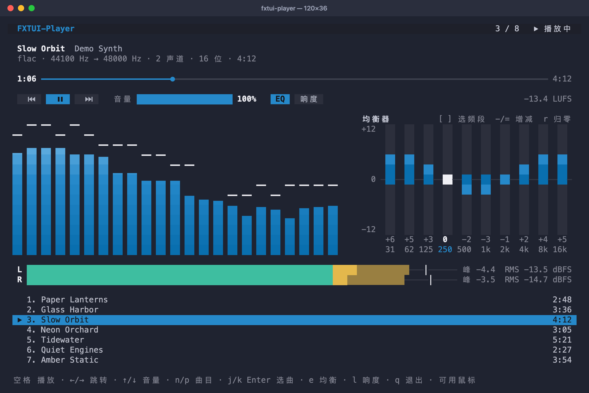

# FXTUI-Player

A full-screen terminal music player with keyboard and mouse control.

[简体中文](README.zh-CN.md)



## Features

- Formats: MP3, AAC (`.m4a` `.mp4` `.aac`), ALAC, FLAC, Vorbis (`.ogg`), Opus, WAV, AIFF, CAF.
  The decoders are built in; no ffmpeg or system codecs are needed.
- Gapless playback, with automatic resampling to the device rate.
- Accurate seeking: click or drag the progress bar, or jump with the keys.
- 10-band graphic equalizer: 31 Hz – 16 kHz, ±12 dB per band, adjustable with the mouse or the keys.
  Changes glide smoothly, and headroom is added automatically so boosts do not clip.
- Loudness normalisation: each track is brought to −14 LUFS (ITU-R BS.1770) with a true-peak limiter at −1 dBTP.
- Live spectrum (log bands, peak hold), stereo peak / RMS meters and a momentary loudness readout.
- Playlist with titles and durations: click to select, double click to play, wheel to scroll.
- The layout follows the terminal size (40×12 at least).

## Controls

| Key | Mouse | Action |
| --- | --- | --- |
| Space | click ⏸ / ▶ | play / pause |
| ← / → | — | back / forward 5 s |
| 0–9 | click or drag the progress bar | jump to 0%–90% / the clicked position |
| ↑ / ↓ | click, drag or wheel on the volume bar | volume |
| n / p | click ⏭ / ⏮ | next / previous track |
| j / k | click a playlist row | select |
| Enter | double click a row | play the selected track |
| PgUp / PgDn | wheel on the playlist | page / scroll |
| e | click EQ | equalizer on / off (shows the 10-band panel) |
| [ / ] | click a band | pick a band |
| - / = | drag a band, or wheel on it | that band −1 / +1 dB |
| r | — | flatten the equalizer |
| l | click 响度 | loudness normalisation on / off |
| q / Ctrl-C | — | quit |

The interface text is in Simplified Chinese.

## Requirements

- macOS 14 or later on Apple silicon (arm64).
- A truecolor terminal with mouse support, such as iTerm2, Ghostty, kitty or WezTerm.
  Without mouse support the keyboard still works.

## Usage

Download the binary from [Releases](../../releases), or build it yourself, then:

```sh
fxtui-player ~/Music/album track.flac
```

Arguments are files or directories, played in the order given; a directory contributes its audio files, sorted by name.

## Building

The player is written in the FLYEX language. Building it needs the FLYEX compiler with its SDK, and the Xcode
command line tools.

```sh
./build.sh                                             # uses flyex on PATH
FLYEX=/path/to/flyex FLYEX_STD=/path/to/sdk ./build.sh # explicit compiler and SDK directory
```

The result is `build/fxtui-player`.

## License

[MIT](LICENSE)
