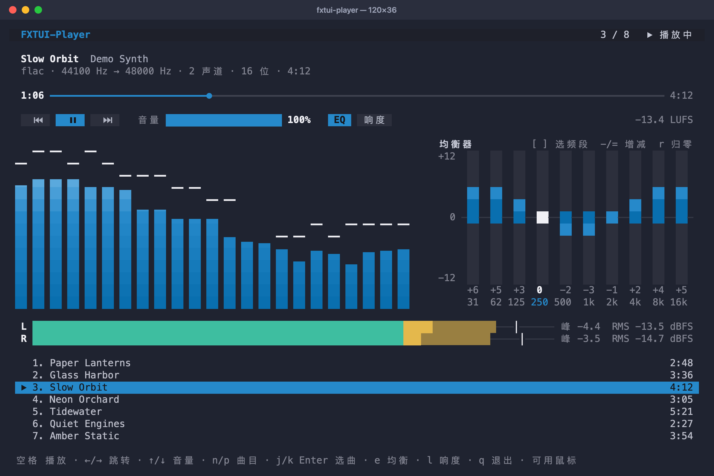

# FXTUI-Player

全屏终端音乐播放器，键盘和鼠标都能操作。

[English](README.md)



## 特性

- 格式：MP3、AAC（`.m4a` `.mp4` `.aac`）、ALAC、FLAC、Vorbis（`.ogg`）、Opus、WAV、AIFF、CAF。
  解码器是自带的，不依赖 ffmpeg 或系统编解码器。
- 无缝播放：曲目之间不停顿，采样率不同的曲目自动重采样到设备采样率。
- 精确跳转：点击或拖动进度条，或用按键跳到指定位置。
- 十段图形均衡器：31 Hz – 16 kHz，每段 ±12 dB，可用鼠标或按键调节。调节时平滑过渡，并自动留出余量防止削波。
- 响度归一化：按 ITU-R BS.1770 把每首曲目归一到 −14 LUFS，真峰值限幅到 −1 dBTP。
- 实时频谱（对数频段、峰值保持）、左右声道峰值 / RMS 电平表、即时响度读数。
- 播放列表：显示标题与时长，单击选中、双击播放，滚轮滚动。
- 界面随终端大小自动布局（最小 40×12）。

## 操作

| 按键 | 鼠标 | 作用 |
| --- | --- | --- |
| 空格 | 点 ⏸ / ▶ | 播放 / 暂停 |
| ← / → | — | 后退 / 前进 5 秒 |
| 0–9 | 点或拖动进度条 | 跳到 0%–90% / 点中的位置 |
| ↑ / ↓ | 点、拖动音量条，或在上面滚轮 | 音量 |
| n / p | 点 ⏭ / ⏮ | 下一首 / 上一首 |
| j / k | 点播放列表的一行 | 选中 |
| Enter | 双击一行 | 播放选中的曲目 |
| PgUp / PgDn | 在播放列表上滚轮 | 翻页 / 滚动 |
| e | 点 EQ | 均衡器 开 / 关（打开后显示十段面板） |
| [ / ] | 点某一段 | 选择频段 |
| - / = | 拖动某一段，或在上面滚轮 | 该频段 −1 / +1 dB |
| r | — | 均衡器归零 |
| l | 点 响度 | 响度归一化 开 / 关 |
| q / Ctrl-C | — | 退出 |

## 运行环境

- macOS 14 及以上，Apple 芯片（arm64）。
- 支持真彩色和鼠标的终端，例如 iTerm2、Ghostty、kitty、WezTerm。终端不支持鼠标时只有键盘可用。

## 使用

从 [Releases](../../releases) 下载编译好的二进制，或自己构建，然后：

```sh
fxtui-player ~/Music/专辑 单曲.flac
```

参数是文件或目录，按给出的顺序播放；目录取其中的音频文件，按文件名排序。

## 构建

播放器用 FLYEX 语言编写，构建需要 FLYEX 编译器及其 SDK，以及 Xcode 命令行工具。

```sh
./build.sh                                             # 用 PATH 上的 flyex
FLYEX=/path/to/flyex FLYEX_STD=/path/to/sdk ./build.sh # 指定编译器和 SDK 目录
```

产物是 `build/fxtui-player`。

## 许可证

[MIT](LICENSE)
